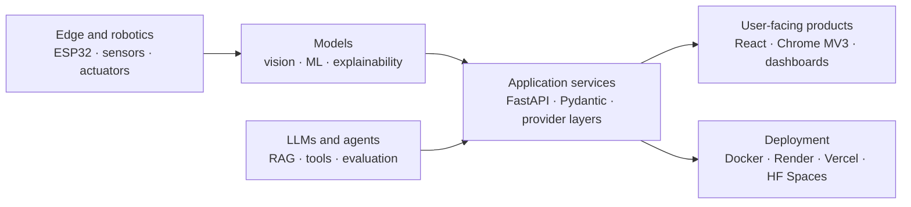

<div align="center">


# Mohammad Fayas Khan

### Software Engineer · AI/ML · Computer Vision · Agentic Systems

<p>
  <a href="https://linkedin.com/in/mohammadfayaskhan">LinkedIn</a> ·
  <a href="https://github.com/MohammadFayasKhan">GitHub</a> ·
  <a href="https://leetcode.com/u/fayaskhanx/">LeetCode</a> ·
  <a href="mailto:fayaskhanmohammad@gmail.com">Email</a>
</p>


</div>

<br/>

I am a Computer Science Engineering student at **Lovely Professional University** building practical software across AI, full-stack systems, and embedded hardware. My work spans the complete path from model training and deterministic business logic to APIs, interfaces, deployment, and real-world device integration.

My strongest interests are **computer vision, LLM applications, agentic workflows, applied machine learning, and edge/IoT systems**. I prefer systems where the model is useful but bounded: validated outputs, deterministic calculations, explicit fallbacks, and clear observability.

> **Currently open to:** Software Engineering internships · AI/ML roles · applied research · open-source collaborations

## Profile at a glance

| Area | Details |
|---|---|
| Education | B.Tech Computer Science and Engineering, LPU · 2024–2028 |
| Academic record | CGPA **9.66/10** · University Honor Roll 2025 · AI/ML Minor |
| Primary languages | C++, Python, TypeScript, JavaScript, C, Java, SQL |
| AI/ML | PyTorch, EfficientNetV2-S, YOLO, Mobile-UNet, OpenCV, scikit-learn, Grad-CAM |
| LLM engineering | FastAPI, Pydantic, Groq, Gemini, LangChain, LangGraph, RAG, tool calling, LoRA/QLoRA |
| Product engineering | React, Vite, Tailwind CSS, Chrome MV3, Node.js, Docker |
| Hardware | ESP32, ESP32-CAM, ESP8266, Arduino, sensors, 4-DOF robotics |
| Deployment | Hugging Face Spaces, Render, Vercel, Docker, Linux, GitHub |

## What I build



### Engineering principles

- **Keep critical logic deterministic.** Attendance calculations, safety defaults, validation, and business rules should not depend on an LLM.
- **Treat model output as untrusted.** Use schemas, repair paths, provider fallbacks, retries, and explicit failure states.
- **Design for the real interface.** Hardware projects account for sensor availability, latency, power-up behavior, and train/deploy parity.
- **Explain results, not just predictions.** Use Grad-CAM, traces, metrics, and transparent UI states to make systems inspectable.

## Selected work

### AI Powered Crop Intelligence Rover

**Computer vision · edge robotics · explainable AI · FastAPI · React**

A field rover that combines leaf disease detection, environmental telemetry, a 4-DOF arm, and a dashboard for field-risk monitoring.

| Component | Implementation |
|---|---|
| Classification | EfficientNetV2-S trained on approximately 54K images across 38 classes |
| Results | **95.13% test accuracy** and **0.9354 macro F1** |
| Vision pipeline | YOLO detection, Mobile-UNet segmentation, and Grad-CAM heatmaps |
| Hardware | ESP32, ESP32-CAM, environmental sensors, and a 4-DOF robotic arm |
| Product layer | FastAPI inference service and React dashboard for predictions, heatmaps, telemetry, and risk insights |
| Interaction | XiaoZhi voice-based field interaction |
| Links | [Repository](https://github.com/MohammadFayasKhan/AIPoweredCropIntelligenceRover) · [Live site](https://aipoweredcropintelligencerover.dpdns.org) · [Demo](https://youtu.be/BdzizjHH6jI) |

**Design decision:** the system does not stop at classification. It combines model explanations with live sensor context so a user can understand both *what* was detected and *why the field conditions matter*.

### LPU UMS Agent

**Agentic browser automation · Chrome MV3 · TypeScript · FastAPI**

An agentic Chrome extension for live LPU UMS sessions, designed around a closed-loop observe → ground → act → re-observe → verify workflow.

| Component | Implementation |
|---|---|
| Workflows | Attendance analysis, exam date-sheet, and seating-plan automation |
| Extraction | DOM-first extraction with validation across legacy tables and Angular card layouts |
| Grounding | IoU and text-similarity checks before browser actions |
| Reliability | Three-model fallback chain and **139 automated tests** |
| Safety | Human-controlled CAPTCHA/security steps; no credential or cookie handling |
| Privacy | IndexedDB local-first storage, stateless backend, minimal course context |
| Link | [Repository](https://github.com/MohammadFayasKhan/LpuUmsAgent) |

**Design decision:** the LLM never owns the numbers that matter. Attendance calculations remain deterministic and outside the model; the agent is used for interpretation, grounding, and controlled interaction.

### Code Explain

**LLM application · React · Monaco Editor · FastAPI · Docker**

An AI code tutor that provides plain-English explanations, line-by-line commentary, complexity analysis, test-case traces, quizzes, and follow-up chat.

| Component | Implementation |
|---|---|
| Frontend | React, TypeScript, and Monaco Editor |
| API | Five stateless FastAPI endpoints with client-side history |
| Output safety | Pydantic validation and one-shot self-repair |
| Model routing | Provider abstraction across Groq and Gemini with fallback and exponential backoff |
| Deployment | Multi-stage Docker build deployed on Render |
| Link | [Repository](https://github.com/MohammadFayasKhan/CodeExplain) |

**Design decision:** every model response is treated as untrusted data. Invalid output is repaired once, then routed to the next provider rather than silently returned to the user.

### Smart Crop Intelligence System

**Applied ML · IoT · FastAPI · Hugging Face Spaces**

A sensor-driven crop recommendation and plant-health platform designed around the exact features available on the target hardware.

| Metric or component | Detail |
|---|---|
| Model | RandomForestClassifier with 300 estimators and GridSearchCV tuning |
| Results | **93.18% accuracy**, **93.10% macro F1**, **91.82% OOB score** |
| Dataset | 2,200 balanced samples across 22 crop classes |
| Latency | **27.61 ms** average end-to-end inference |
| Hardware | ESP8266 NodeMCU, DHT11, rain sensor, and soil-moisture probe |
| API | `/predict` dashboard endpoint and memory-optimized `/predict/compact` endpoint |
| Links | [Repository](https://github.com/MohammadFayasKhan/smart-crop-intelligene-system) · [Live demo](https://fayasx-smart-plant.hf.space) |

**Design decision:** training uses only sensor-measurable variables, avoiding train/deploy feature mismatch between the dataset and the embedded device.

### Other shipped projects

| Project | Summary | Link |
|---|---|---|
| CPU Sched | React/Vite simulator for FCFS, SJF, SRTF, Round Robin, and Priority Scheduling with animated Gantt charts | [Repo](https://github.com/MohammadFayasKhan/cpuSched) · [Live](https://cpu-sched.vercel.app) |
| Smart Home Automation Socket | ESP8266 HAP server for native Apple HomeKit control, with active-LOW relay safety and no cloud bridge | [Repo](https://github.com/MohammadFayasKhan/SmartHomeAutomationSocket) |
| Face Attendance System | dlib recognition, geotagging, FastAPI, React, Tailwind CSS, and SQLite | [Repo](https://github.com/MohammadFayasKhan/Face-Attendance-System) · [Live](https://studentsfaceattendancesystem.vercel.app/) |
| Attention Is All You Need | Interactive visual learning experience for Transformers, self-attention, and the original paper | [Repo](https://github.com/MohammadFayasKhan/AttentionIsAllYouNeed) |
| DeskBuddy | ESP32 OLED desk companion with animated eyes, weather, and clock | [Repo](https://github.com/MohammadFayasKhan/DeskBuddy) |
| FayasAI | ESP32 voice assistant with an animated OLED interface, Groq Whisper, and Llama 3.3 | [Repo](https://github.com/MohammadFayasKhan/FayasAI) |
| NeetCode submissions | C++ problem-solving practice and algorithm implementations | [Repo](https://github.com/MohammadFayasKhan/neetcode-submissions) |

## Technical capabilities

<details>
<summary><b>Languages, frameworks, and infrastructure</b></summary>

<br/>

| Category | Tools |
|---|---|
| Languages | C++, Python, C, Java, JavaScript, TypeScript, SQL |
| Frontend | React, Vite, Tailwind CSS, HTML, CSS, Monaco Editor, Zustand |
| Backend | FastAPI, Pydantic, Node.js, Express |
| ML and data | PyTorch, scikit-learn, OpenCV, YOLO, EfficientNetV2-S, Mobile-UNet, dlib, Pandas, NumPy, Matplotlib |
| LLM systems | LangChain, LangGraph, RAG, tool calling, structured outputs, guardrails, LLM evaluation, LoRA/QLoRA |
| Data stores | PostgreSQL, MySQL, SQLite, Firebase, Supabase, IndexedDB |
| Embedded | ESP32, ESP32-CAM, ESP8266, Arduino, Blynk, DHT11, rain and soil-moisture sensors |
| Delivery | Docker, Git, GitHub, Linux, Vercel, Render, Hugging Face Spaces, Selenium |

</details>

## Experience, credentials, and recognition

| Period | Milestone |
|---|---|
| Jun–Jul 2026 | Completed LPU's 50-hour AI Engineer Launchpad covering LLMs, RAG, tool calling, LoRA/QLoRA, FastAPI, guardrails, and evaluation |
| Sep 2026 | Led Team Innovex into the top 30 hardware teams out of 900+ at LPU GearUp Season 5 |
| 2026 | Accepted contributor, GirlScript Summer of Code (GSSoC '26) |
| 2025 | Cleared JPMorgan Chase Code For Good HackerRank round and received a HireVue invitation |
| 2025 | University Honor Roll recognition for academic performance |
| 2025–2026 | Oracle AI Foundations and Agentic AI Foundations certifications |
| 2025 | NASSCOM foundations in Machine Learning/Image Processing and Chatbot/Smart Assistant Development |
| 2025 | Infosys Springboard Programming Using C++, Google Analytics, and n8n Academy certifications |

## Academic record

| Term | TGPA | Core subjects |
|---|---:|---|
| Semester 1 | 9.55 | Python, Computing, Engineering Mathematics |
| Semester 2 | 9.63 | DBMS, Software Engineering, Programming, Discrete Mathematics |
| Semester 3 | 9.76 | OOP, DSA, Computer Networks, Probability and Statistics |
| Semester 4 | 9.72 | Operating Systems, DAA, Theory of Computation, Computer Organization |
| **Overall** | **9.66** | **University Honor Roll · AI/ML Minor** |

| Institution | Program | Result |
|---|---|---:|
| Lovely Professional University, Phagwara | B.Tech CSE · 2024–2028 | CGPA 9.66 |
| Sri Chaitanya Education Institutions, Vijayawada | Intermediate Science · 2022–2024 | 95.7% |
| Komma Reddy High School, Bantumilli | Matriculation · 2021–2022 | 95.6% |

## Current focus

```yaml
primary:
  track: C++ data structures and algorithms
  roadmap: Striver A2Z
  practice: 25-minute cold-solve attempt before hints
  target: 200+ problems by Semester 6

secondary:
  track: Applied AI/ML
  focus: Computer vision, LLMs, agentic AI, RAG, deep learning, NLP
  approach: End-to-end systems with deployment and measurable evaluation

building:
  - Crop Intelligence Rover improvements
  - Agentic tools with deterministic guardrails
  - Open-source contributions through GSSoC '26
  - Reliable backend APIs and intelligent applications
```

## Analytics

<div align="center">


&nbsp;


<br/><br/>


</div>

## Connect

If you are building a useful product, an applied AI system, or an embedded project with a strong software layer, I would be glad to collaborate.

<div align="center">

<a href="mailto:fayaskhanmohammad@gmail.com"></a>
<a href="https://linkedin.com/in/mohammadfayaskhan"></a>

<br/><br/>

*Building intelligent software at the intersection of AI/ML, full-stack engineering, and embedded systems.*


</div>
