  

<a href="https://linkedin.com/in/mohammadfayaskhan"><picture><source media="(prefers-color-scheme: dark)" srcset="https://img.shields.io/badge/LINKEDIN-0d1117?style=flat-square&logo=linkedin&logoColor=ffffff"/></picture></a>
<a href="https://github.com/MohammadFayasKhan"><picture><source media="(prefers-color-scheme: dark)" srcset="https://img.shields.io/badge/GITHUB-0d1117?style=flat-square&logo=github&logoColor=ffffff"/></picture></a>
<a href="https://leetcode.com/u/fayaskhanx/"><picture><source media="(prefers-color-scheme: dark)" srcset="https://img.shields.io/badge/LEETCODE-0d1117?style=flat-square&logo=leetcode&logoColor=ffffff"/></picture></a>
<a href="mailto:fayaskhanmohammad@gmail.com"><picture><source media="(prefers-color-scheme: dark)" srcset="https://img.shields.io/badge/EMAIL-0d1117?style=flat-square&logo=gmail&logoColor=ffffff"/></picture></a>

  

&nbsp;

&nbsp;

<picture><source media="(prefers-color-scheme: dark)" srcset="assets/dark/s01.svg"/></picture>
<picture><source media="(prefers-color-scheme: dark)" srcset="assets/dark/whoami.svg"/></picture>

<b>👋 The longer story</b>

 

I am a **Computer Science Engineering** student at **Lovely Professional University** (B.Tech, 2024 to 2028) with a **9.66 CGPA**, a place on the **University Honor Roll 2025**, and an **AI/ML Minor**. I build AI that leaves the notebook: a vision-powered field rover, an agentic assistant that works inside live browser sessions, and an LLM tutor shipped with Docker.

- 🧠 **Applied AI** → CNN classifiers, YOLO detection, segmentation, Grad-CAM explainability, RAG, tool calling, LoRA/QLoRA, agentic workflows
- 🤖 **AI + hardware** → ESP32 / ESP32-CAM rovers, sensor telemetry, 4-DOF robotic arms, edge-to-cloud pipelines
- ⚙️ **Full stack** → FastAPI backends, React + TypeScript frontends, Chrome MV3 extensions, Dockerized deployments
- 🧩 **Fundamentals** → DSA in **C++** (Striver A2Z), OS, DBMS, Computer Networks, OOP
- 🏆 **Leadership** → Team Leader of **Team Innovex**, top 30 hardware teams out of 900+ at **LPU GearUp Season 5**
- 🌍 **Open source** → contributor in **GSSoC '26**

<picture><source media="(prefers-color-scheme: dark)" srcset="assets/dark/s02.svg"/></picture>
<picture><source media="(prefers-color-scheme: dark)" srcset="assets/dark/ecosystem.svg"/></picture>

<picture><source media="(prefers-color-scheme: dark)" srcset="assets/dark/s03.svg"/></picture>
<picture><source media="(prefers-color-scheme: dark)" srcset="assets/dark/projects.svg"/></picture>

<b>🔗 Project links, live demos and details</b>

 

| Project | What it does | Links |
|---|---|---|
| 🌾 **AI Powered Crop Intelligence Rover** | EfficientNetV2-S on ~54K images / 38 classes (95.13% acc, 0.9354 macro F1), YOLO + Mobile-UNet + Grad-CAM, ESP32 + ESP32-CAM rover with 4-DOF arm, XiaoZhi voice, FastAPI + React dashboard | [Repo](https://github.com/MohammadFayasKhan/AIPoweredCropIntelligenceRover) · [Live](https://aipoweredcropintelligencerover.dpdns.org) · [Demo](https://youtu.be/BdzizjHH6jI) |
| 🧭 **LPU UMS Agent** | Agentic MV3 Chrome extension automating attendance analysis, exam date-sheet and seating plan, with a 3-model LLM fallback and 139 tests | [Repo](https://github.com/MohammadFayasKhan/LpuUmsAgent) |
| 🎓 **Code Explain** | AI code tutor: explanations, line-by-line commentary, complexity analysis, traces, quizzes, follow-up chat. Docker on Render | [Repo](https://github.com/MohammadFayasKhan/CodeExplain) |
| 🌿 **Smart Crop Intelligence System** | RandomForest (300 trees, 93.18% acc, 93.10% macro F1), 22 crops, ESP8266 sensors, 27.61ms latency | [Repo](https://github.com/MohammadFayasKhan/smart-crop-intelligene-system) · [Live](https://fayasx-smart-plant.hf.space) |
| ⚙️ **CPU Sched** | 5 scheduling algorithms, animated Gantt charts, Compare All mode, built-in Convoy Effect and Starvation scenarios, MIT licensed | [Repo](https://github.com/MohammadFayasKhan/cpuSched) · [Live](https://cpu-sched.vercel.app) |
| 🏠 **Smart Home Automation Socket** | Full HomeKit (HAP) server on an ESP8266, 80 lines of C++, Siri control, no cloud or bridge | [Repo](https://github.com/MohammadFayasKhan/SmartHomeAutomationSocket) |
| 👨🏻‍💻 **Face Attendance System** | dlib face recognition + geotagging, FastAPI + React + SQLite | [Repo](https://github.com/MohammadFayasKhan/Face-Attendance-System) · [Live](https://studentsfaceattendancesystem.vercel.app/) |

<picture><source media="(prefers-color-scheme: dark)" srcset="assets/dark/s04.svg"/></picture>
<picture><source media="(prefers-color-scheme: dark)" srcset="assets/dark/rover.svg"/></picture>
<picture><source media="(prefers-color-scheme: dark)" srcset="assets/dark/agent.svg"/></picture>
<picture><source media="(prefers-color-scheme: dark)" srcset="assets/dark/gateway.svg"/></picture>

<b>🧪 Engineering decisions I'm proud of</b>

 

- 🌾 **Rover → explain, don't just predict.** Grad-CAM heatmaps show *why* a leaf was flagged, and field-risk insights fuse image predictions with live sensor telemetry instead of relying on the image alone.
- 🧭 **UMS Agent → the LLM never touches the numbers.** Attendance calculations are deterministic and live outside the model. The agent only observes, grounds and verifies, with a human in control of CAPTCHA and security steps.
- 🔐 **UMS Agent → privacy first.** IndexedDB local storage, a stateless backend, no credential or cookie handling, and only minimal course context sent to the LLM.
- 🎓 **Code Explain → treat LLM output as untrusted.** Every response is validated with Pydantic, gets one self-repair attempt, then falls over to the next of 3 models with exponential-backoff retries.
- 🌿 **Smart Crop → no train-deploy mismatch.** The model trains only on sensor-measurable features, so what the hardware reads is exactly what the model saw in training.
- 🏠 **HomeKit Socket → safe by default.** Active-LOW relay logic means both outputs stay OFF at power-up.

<picture><source media="(prefers-color-scheme: dark)" srcset="assets/dark/s05.svg"/></picture>
<picture><source media="(prefers-color-scheme: dark)" srcset="assets/dark/telemetry.svg"/></picture>

<picture><source media="(prefers-color-scheme: dark)" srcset="https://github-readme-stats.vercel.app/api?username=MohammadFayasKhan&show_icons=true&theme=tokyonight&bg_color=00000000&hide_border=true&include_all_commits=true&count_private=true"/></picture>
&nbsp;
<picture><source media="(prefers-color-scheme: dark)" srcset="https://github-readme-stats.vercel.app/api/top-langs/?username=MohammadFayasKhan&layout=compact&theme=tokyonight&bg_color=00000000&hide_border=true&langs_count=8"/></picture>

  

<picture><source media="(prefers-color-scheme: dark)" srcset="https://nirzak-streak-stats.vercel.app/?user=MohammadFayasKhan&theme=tokyonight&background=00000000&hide_border=true"/></picture>

  

<picture><source media="(prefers-color-scheme: dark)" srcset="https://github-readme-activity-graph.vercel.app/graph?username=MohammadFayasKhan&bg_color=00000000&color=ffffff&line=A78BFA&point=ffffff&area_color=A78BFA&area=true&hide_border=true&radius=0&custom_title=CONTRIBUTION%20TELEMETRY"/></picture>

<picture><source media="(prefers-color-scheme: dark)" srcset="assets/dark/s06.svg"/></picture>
<picture><source media="(prefers-color-scheme: dark)" srcset="assets/dark/timeline.svg"/></picture>

<picture><source media="(prefers-color-scheme: dark)" srcset="assets/dark/s07.svg"/></picture>
<picture><source media="(prefers-color-scheme: dark)" srcset="assets/dark/credentials.svg"/></picture>
<picture><source media="(prefers-color-scheme: dark)" srcset="assets/dark/academics.svg"/></picture>

<b>🏅 Certification badges and training detail</b>

 

**AI Engineer Launchpad: Mastering LLMs and Agentic AI** (LPU, Jun to Jul 2026) → a 50-hour, 5-week hands-on program covering Generative AI, LLMs, Transformer architecture, tokenization, prompt engineering, LLM APIs, structured outputs, REST API design and FastAPI. Applied function / tool calling, LoRA/QLoRA fine-tuning, RAG, agentic workflows, LLM evaluation and guardrails, ending in the **Code Explain** capstone.

<picture><source media="(prefers-color-scheme: dark)" srcset="assets/dark/s08.svg"/></picture>
<picture><source media="(prefers-color-scheme: dark)" srcset="assets/dark/stack.svg"/></picture>

<picture><source media="(prefers-color-scheme: dark)" srcset="assets/dark/s09.svg"/></picture>
<picture><source media="(prefers-color-scheme: dark)" srcset="assets/dark/roadmap.svg"/></picture>

**🤝 Let's build something.** Internships, open source collabs, or AI + hardware ideas → I'm all ears.

<picture><source media="(prefers-color-scheme: dark)" srcset="assets/dark/footer.svg"/></picture>

<!-- one responsive picture per visual; no duplicate light/dark rendering -->
